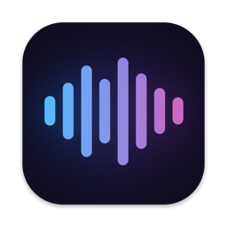

<p align="center">
  
</p>

<h1 align="center">Meeting Notes</h1>

<p align="center">
  Record any meeting on your Mac. Get a clean transcript with speakers and a summary you can paste straight into Notion.<br>
  Transcription runs fully on your Mac. No bot joins your call.
</p>

<p align="center">
  <a href="https://github.com/ph1lb4/meeting-notes/releases/latest"><b>Download for macOS</b></a>
</p>

## Why

Meeting bots are awkward, cloud transcription is a privacy question, and most notes apps want a subscription. Meeting Notes sits in your menu bar, listens to your mic and to the call audio on your Mac, and does the rest locally.

## Features

- **Works with every call app.** Zoom, Teams, Google Meet in the browser, Slack huddles. Call audio comes from a Core Audio process tap, so there is nothing to install in the call.
- **Local transcription.** [WhisperKit](https://github.com/argmaxinc/argmax-oss-swift) runs Whisper on the Apple Neural Engine. German and English are detected automatically, once per speaker track, so lines do not get translated by mistake.
- **Speakers.** Your mic is you. The call audio is split into Speaker 1, 2, 3 with Pyannote (SpeakerKit). In-person meeting? Then the mic gets split instead. Click a speaker to rename them.
- **Live, then clean.** Text shows up while you talk. After you hit Stop, a second, more accurate pass runs over the full recording and adds the speaker labels.
- **Cleaner transcripts.** Claude fixes misheard words, names and terms after each meeting. Add your own vocabulary in Settings. One click undoes the fixes.
- **Your own notes.** Type notes during the meeting. They get a timestamp and land in the transcript and the summary.
- **Summaries.** Summary, key points, open questions, a decision log and action items. Long or short, your pick. Written by the [Claude Code](https://claude.com/claude-code) CLI if you have it, or by Apple Intelligence fully on device.
- **Plain files.** Every meeting is a folder with Markdown files. No database, no account, no lock in.
- **Notion ready.** One click copies clean Markdown with headings, bullets and `- [ ]` to-dos.
- **Send to Notion or Linear.** If your Claude Code has the Notion or Linear MCP connected, one click files the meeting there: a Notion page, or one Linear issue per action item. Claude tells you where it went.

## Install

1. Download **`MeetingNotes-x.y.z.dmg`** from the [latest release](https://github.com/ph1lb4/meeting-notes/releases/latest).
2. Drag **Meeting Notes** into Applications and open it. The app is signed and notarized.
3. Hit **Record**. macOS asks for **Microphone** and **System Audio Recording** access once.

After that the app keeps itself up to date. It checks for a new version once a day, and you can check by hand in Settings or with **Check for Updates…**. Versions up to 0.1.2 have no updater, so install the next version by hand one more time.

The Whisper model (about 630 MB to 3 GB, you pick in Settings) and the speaker model download on first use. After that everything works offline.

For summaries, either install and log in to [Claude Code](https://claude.com/claude-code), or turn on Apple Intelligence (macOS 26+).

**Requirements:** macOS 15 or later, Apple silicon.

## Privacy

- Audio, transcription and speaker detection stay on your Mac.
- Recordings are written to `~/Library/Application Support/MeetingNotes/Recordings/`, outside any iCloud synced folder, and deleted after the final transcript unless you turn on "Keep audio".
- With **Claude** as the summary engine, the transcript and your notes are sent to Anthropic when a summary is written or the transcript is fixed. Pick **Apple Intelligence only** in Settings, or turn off auto summary, to keep everything local.
- Call capture records all sound your Mac plays. Tell the people in the call that you are recording.
- The update check asks github.com for the latest version once a day. It sends no data about you or your Mac. You can turn it off in Settings.

## Where your notes live

```
~/Documents/Meeting Notes/
  2026-11-10 09-00 Onboarding launch plan/
    transcript.md   your notes + full transcript
    summary.md      summary, decisions and action items
    meeting.json    app state
    audio/          only with "Keep audio"
```

You can change the folder in Settings. Point it at iCloud Drive or an Obsidian vault if you like.

## Build from source

```sh
brew install xcodegen
xcodegen generate
open MeetingNotes.xcodeproj
```

Run the tests:

```sh
xcodebuild -project MeetingNotes.xcodeproj -scheme MeetingNotes -derivedDataPath build test
```

Headless self test of the full pipeline on two audio files:

```sh
"build/Build/Products/Debug/Meeting Notes.app/Contents/MacOS/Meeting Notes" --selftest mic.wav system.wav [--no-claude]
```

### Release build

`build_release.sh` builds a Developer ID signed app, packs a DMG, notarizes and staples it. Models are not bundled. From a fork, set your own identity:

```sh
SIGN_IDENTITY="Developer ID Application: Your Name (TEAMID)" TEAM_ID=TEAMID NOTARY_PROFILE=your-profile ./build_release.sh
```

### Updates

The app updates itself with [Sparkle](https://sparkle-project.org). It reads `appcast.xml` from the latest GitHub release. Each update is signed with a private update key, and the app only installs updates that match the public key in `SUPublicEDKey` (`project.yml`). While that key is empty, the updater is off.

One-time setup:

1. Run `xcodebuild -resolvePackageDependencies -project MeetingNotes.xcodeproj -scheme MeetingNotes -derivedDataPath build/release`, so that the Sparkle tools exist.
2. Run `build/release/SourcePackages/artifacts/sparkle/Sparkle/bin/generate_keys`. It stores the private key in your login Keychain and prints the public key.
3. Put the public key into `SUPublicEDKey` in `project.yml`, run `xcodegen generate` and commit.
4. Back up the private key: `generate_keys -x sparkle_private_key`, store the file in a password manager, then delete it. Without the key you cannot ship updates to installed apps any more.

For each release:

1. Raise `CFBundleShortVersionString` and `CFBundleVersion` in `project.yml`, run `xcodegen generate` and commit. Sparkle compares `CFBundleVersion`, so it must go up every time.
2. Run `./build_release.sh`. It also writes `dist/appcast.xml`. The feed holds a signature of that exact DMG, so always upload the two files of the same run.
3. Create the GitHub release as a draft with the tag `v<version>`, upload both `dist/MeetingNotes-<version>.dmg` and `dist/appcast.xml`, then publish it. It must be the latest release, not a pre-release, because the app reads `releases/latest/download/appcast.xml`.

From a fork, change `SUFeedURL` in `project.yml` to your repository and use your own key. Otherwise your app reads the feed of this repository and rejects its updates. `SPARKLE_KEY_FILE` points the script at a key file instead of the Keychain.

## Credits

- [Sparkle](https://sparkle-project.org) for updates (MIT)
- [WhisperKit and SpeakerKit](https://github.com/argmaxinc/argmax-oss-swift) by Argmax (MIT)
- [Whisper](https://github.com/openai/whisper) by OpenAI (MIT)
- [pyannote](https://github.com/pyannote/pyannote-audio) speaker diarization (MIT)

## License

[MIT](LICENSE)
