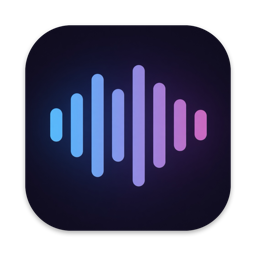

<p align="center">
  
</p>

<h1 align="center">Meeting Notes</h1>

<p align="center">
  Record any meeting on your Mac. Get a clean transcript with speakers and a summary you can paste straight into Notion.<br>
  Transcription runs fully on your Mac. No bot joins your call.
</p>

<p align="center">
  <a href="https://github.com/ph1lb4/meeting-notes/releases/latest"><b>Download for macOS</b></a>
</p>

## Why

Meeting bots are awkward, cloud transcription is a privacy question, and most notes apps want a subscription. Meeting Notes sits in your menu bar, listens to your mic and to the call audio on your Mac, and does the rest locally.

## Features

- **Works with every call app.** Zoom, Teams, Google Meet in the browser, Slack huddles. Call audio comes from a Core Audio process tap, so there is nothing to install in the call.
- **Local transcription.** [WhisperKit](https://github.com/argmaxinc/argmax-oss-swift) runs Whisper on the Apple Neural Engine. German and English are detected automatically.
- **Speakers.** Your mic is you. The call audio is split into Speaker 1, 2, 3 with Pyannote (SpeakerKit). In-person meeting? Then the mic gets split instead. Click a speaker to rename them.
- **Live, then clean.** Text shows up while you talk. After you hit Stop, a second, more accurate pass runs over the full recording and adds the speaker labels.
- **Your own notes.** Type notes during the meeting. They get a timestamp and land in the transcript and the summary.
- **Summaries.** Summary, key points, decisions, open questions and action items. Written by the [Claude Code](https://claude.com/claude-code) CLI if you have it, or by Apple Intelligence fully on device.
- **Plain files.** Every meeting is a folder with Markdown files. No database, no account, no lock in.
- **Notion ready.** One click copies clean Markdown with headings, bullets and `- [ ]` to-dos.

## Install

1. Download **`MeetingNotes-x.y.z.dmg`** from the [latest release](https://github.com/ph1lb4/meeting-notes/releases/latest).
2. Drag **Meeting Notes** into Applications and open it. The app is signed and notarized.
3. Hit **Record**. macOS asks for **Microphone** and **System Audio Recording** access once.

The Whisper model (about 630 MB to 1.6 GB, you pick in Settings) and the speaker model download on first use. After that everything works offline.

For summaries, either install and log in to [Claude Code](https://claude.com/claude-code), or turn on Apple Intelligence (macOS 26+).

**Requirements:** macOS 15 or later, Apple silicon.

## Privacy

- Audio, transcription and speaker detection stay on your Mac.
- Recordings are written to `~/Library/Application Support/MeetingNotes/Recordings/`, outside any iCloud synced folder, and deleted after the final transcript unless you turn on "Keep audio".
- With **Claude** as the summary engine, the transcript and your notes are sent to Anthropic when a summary is written. Pick **Apple Intelligence only** in Settings, or turn off auto summary, to keep everything local.
- Call capture records all sound your Mac plays. Tell the people in the call that you are recording.

## Where your notes live

```
~/Documents/Meeting Notes/
  2026-11-10 09-00 Onboarding launch plan/
    transcript.md   your notes + full transcript
    summary.md      summary and action items
    meeting.json    app state
    audio/          only with "Keep audio"
```

You can change the folder in Settings. Point it at iCloud Drive or an Obsidian vault if you like.

## Build from source

```sh
brew install xcodegen
xcodegen generate
open MeetingNotes.xcodeproj
```

Run the tests:

```sh
xcodebuild -project MeetingNotes.xcodeproj -scheme MeetingNotes -derivedDataPath build test
```

Headless self test of the full pipeline on two audio files:

```sh
"build/Build/Products/Debug/Meeting Notes.app/Contents/MacOS/Meeting Notes" --selftest mic.wav system.wav [--no-claude]
```

### Release build

`build_release.sh` builds a Developer ID signed app, packs a DMG, notarizes and staples it. Models are not bundled. From a fork, set your own identity:

```sh
SIGN_IDENTITY="Developer ID Application: Your Name (TEAMID)" TEAM_ID=TEAMID NOTARY_PROFILE=your-profile ./build_release.sh
```

## Credits

- [WhisperKit and SpeakerKit](https://github.com/argmaxinc/argmax-oss-swift) by Argmax (MIT)
- [Whisper](https://github.com/openai/whisper) by OpenAI (MIT)
- [pyannote](https://github.com/pyannote/pyannote-audio) speaker diarization (MIT)

## License

[MIT](LICENSE)
